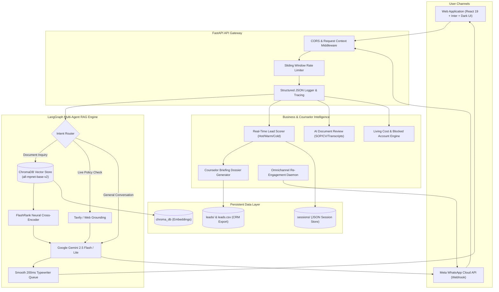

# Margam AI — Enterprise Study Abroad Advisory & RAG Intelligence Platform

[](https://fastapi.tiangolo.com)
[](https://react.dev)
[](https://vitejs.dev)
[](https://tailwindcss.com)
[](https://langchain.com)
[](https://www.trychroma.com)
[](https://ai.google.dev)
[](https://www.docker.com)
[](#license)

Margam AI is a production-grade, omnichannel advisory platform built for international higher education consulting. Combining multi-agent **LangGraph** orchestration, **ChromaDB** dense semantic search, neural **FlashRank** reranking, and **Google Gemini** generative intelligence, Margam AI delivers verified, document-backed guidance on admissions, student visas, blocked accounts, and scholarships across Germany, the UK, the USA, Canada, Australia, Ireland, and France.

The system features real-time Server-Sent Events (SSE) token streaming with a 200ms human-reading typewriter cadence, an omnichannel Meta WhatsApp Business integration, automated lead scoring, counselor CRM intelligence dossiers, and a dark-theme React 19 interface.

---

## Architecture Overview



---

## Core Capabilities

### 1. Multi-Stage RAG & Grounded Intelligence
- **High-Density Vector Ingestion**: Ingests official visa policies, university prospectuses, and blocked account regulations from PDF documents using Recursive Character Chunking ($1000$ chars, $200$ overlap).
- **Dense Semantic Retrieval**: Employs `sentence-transformers/all-mpnet-base-v2` dense embeddings inside **ChromaDB** with Maximal Marginal Relevance (MMR) to guarantee topical diversity.
- **Neural Cross-Encoder Reranking**: Leverages **FlashRank** (`ms-marco-MiniLM-L-12-v2`) to rerank top-$K$ candidates, filtering low-confidence context before prompting the LLM.
- **Zero-Hallucination Citations**: Extracts exact document sources, pages, and snippet references so students receive verifiable advice with clickable citation inspection.
- **Live Web Grounding**: Integrated with Tavily search for real-time validation of fluctuating exchange rates and latest embassy announcements.

### 2. Real-Time Streaming & Typewriter Cadence
- **Server-Sent Events (SSE)**: True server-side live token generation via `/chat/stream`.
- **200ms Typewriter Cadence**: Paced buffer queue on the frontend that interpolates tokens every 200ms for a steady, legible reading experience matching ChatGPT and Claude.
- **Zero Cross-Chat Bleed**: Automatic ticker cancellation and active session synchronization when switching conversations or creating new chats.

### 3. Omnichannel Engagement & WhatsApp Gateway
- **Dual-Channel Parity**: Full feature parity across both Web Chat and Meta WhatsApp Business Cloud API.
- **Webhook Handlers**: Secure challenge verification (`GET /webhook/whatsapp`) and webhook event processing (`POST /webhook/whatsapp`).
- **Autonomous Re-Engagement Nudge Engine**: Identifies dormant conversations ($>20$ hours) and triggers contextual WhatsApp follow-ups with personalized advisory tips.

### 4. Counselor Intelligence & Lead Scoring
- **Automated Lead Categorization**: Automatically categorizes inquiries as **HOT**, **WARM**, or **COLD** based on target intake, budget clarity, academic readiness, and question urgency.
- **Comprehensive Counselor Dossiers**: Generates executive briefings (`/leads/{id}/dossier`) including student background, academic intentions, risk factors, and recommended talking points.
- **CRM Telemetry & Analytics**: Real-time metrics tracking on lead acquisition, conversion readiness, and escalation triggers.

### 5. Interactive Student Utilities
- **Living Cost & Blocked Account Calculator**: Multi-currency engine (EUR, GBP, USD, CAD, AUD) modeling mandatory blocked accounts (e.g. Germany €11,904), health insurance, rent, and monthly allowances.
- **AI Document Reviewer**: Multi-format document parser (PDF, DOCX) providing structured critiques on Statement of Purpose (SOP), CV, and academic transcripts across formatting, tone, and grammar.
- **1-on-1 Strategy Session Booking**: Direct in-app scheduling integrated with Calendly and local slot reservation.
- **Roadmap PDF Export**: One-click generation of personalized study abroad timelines and checklists.

### 6. Modern Human-Crafted Interface
- **Pure Dark Palette**: Locked dark design canvas (`#090E17` / `#0B1120`) with subtle ambient radial dots and glowing aurora blurs.
- **Sticky Desktop Sidebar**: Collapsible persistent drawer (`w-72`) with multi-conversation history, instant session title generation from user prompts, and quick deletion.
- **Inter & JetBrains Mono Typography**: Industry-standard high-legibility interface fonts.
- **100% SVG Iconography**: Strict elimination of emojis in favor of crisp vector SVG icons.

---

## Repository Structure

```
margam-chatbot-main/
├── README.md                           # Production documentation
├── backend/
│   ├── server.py                       # FastAPI application & SSE endpoints
│   ├── requirements.txt                # Python dependencies
│   ├── Dockerfile                      # Production container spec
│   ├── fly.toml                        # Cloud deployment configuration
│   ├── ingest.py                       # Vector ingestion pipeline (PDF -> ChromaDB)
│   ├── lead_scoring.py                 # Algorithmic lead qualification engine
│   ├── session_store.py                # Multi-session state persistence
│   ├── whatsapp_gateway.py             # Meta Cloud WhatsApp integration
│   ├── nudge_engine.py                 # Automated re-engagement cron/worker
│   ├── logging_config.py               # Structured logging & file rotation
│   ├── middleware.py                   # Rate limiting & HTTP request auditing
│   ├── request_context.py              # Correlation ID & request telemetry
│   ├── data/                           # Verified source PDF guides
│   ├── chroma_db/                      # Chroma SQLite vector database
│   └── rag/
│       ├── config.py                   # Centralized configuration & environment loader
│       ├── graph.py                    # LangGraph StateGraph orchestration
│       ├── nodes.py                    # Routing, retrieval, & generation agents
│       └── state.py                    # Graph state typing definition
├── frontend/
│   ├── package.json                    # Node dependencies & build scripts
│   ├── vite.config.ts                  # Vite build & proxy configuration
│   ├── index.html                      # HTML template (Inter font + JetBrains Mono)
│   └── src/
│       ├── App.tsx                     # Main application layout, state & SSE consumer
│       ├── types.ts                    # TypeScript domain interfaces
│       ├── index.css                   # Global Tailwind CSS styling
│       └── components/
│           ├── ChatSidebar.tsx         # Sticky desktop multi-session sidebar
│           ├── CostCalculatorModal.tsx # Financial & blocked account calculator
│           ├── DocumentReviewModal.tsx # AI SOP/CV/Transcript reviewer
│           ├── ConsultationModal.tsx   # 1-on-1 strategy booking dialog
│           ├── StudentProfileDrawer.tsx# Student profile & preference manager
│           ├── CounselorDashboardModal.tsx # Counselor CRM & lead dossier console
│           └── CitationModal.tsx       # Ground-truth source snippet viewer
```

---

## Technology Stack

| Domain | Technology | Version / Model | Purpose |
| :--- | :--- | :--- | :--- |
| **Backend API** | FastAPI / Uvicorn | `0.104+` / `0.24+` | High-throughput asynchronous REST & SSE server |
| **LLM Orchestration** | LangGraph & LangChain | `0.0.20+` / `0.1.0+` | Multi-agent stateful decision and generation graphs |
| **Foundation Models**| Google Gemini | `gemini-2.5-flash` | Reasoning, synthesis, and conversational mentoring |
| **Embeddings** | HuggingFace / PyTorch | `all-mpnet-base-v2` | Dense 768-dimensional semantic embeddings |
| **Vector Database** | ChromaDB | `0.4+` | Local persistence vector database |
| **Reranker** | FlashRank | `ms-marco-MiniLM` | Low-latency neural cross-encoder reranking |
| **Frontend UI** | React 19 + TypeScript | `19.2+` / `5.8+` | Declarative, component-driven client architecture |
| **Styling** | Tailwind CSS | `v4.1+` | Responsive, modern utility CSS styling |
| **Build Tool** | Vite | `v6.2+` | Sub-second HMR and production bundle optimization |
| **End-to-End Tests**| Playwright | `1.65+` | Automated cross-browser verification |
| **Containerization**| Docker | Alpine / Slim 3.11 | Containerized microservice delivery |

---

## Prerequisites

Before deploying or running locally, verify your host has:
- **Python**: Version `3.10` or `3.11`
- **Node.js**: Version `18.x` or `20.x+` (with `npm` or `pnpm`)
- **Google Gemini API Key**: Obtainable from [Google AI Studio](https://aistudio.google.com/)
- **Git**

---

## Quick Start (Local Development)

### 1. Clone the Repository
```bash
git clone https://github.com/your-org/margam-chatbot.git
cd margam-chatbot
```

### 2. Backend Setup
Navigate to `backend`, set up a virtual environment, and install dependencies:
```bash
cd backend

# Create and activate virtual environment
python -m venv .venv

# On Windows:
.\.venv\Scripts\activate
# On Linux/macOS:
source .venv/bin/activate

# Install dependencies
pip install -r requirements.txt
```

#### Configure Environment Variables
Create your `backend/.env` file:
```bash
# LLM Configuration
GEMINI_API_KEY=your_gemini_api_key_here
LLM_PROVIDER=gemini
LLM_MODEL=gemini-2.5-flash
LLM_TEMPERATURE=0.4

# Retrieval & Vector Database
EMBEDDING_MODEL=all-mpnet-base-v2
RETRIEVAL_K=12
USE_RERANKING=false
RERANK_PROVIDER=flashrank

# Web Search (Optional)
USE_WEB_SEARCH=false
TAVILY_API_KEY=your_tavily_api_key_here

# Server & Security
ENVIRONMENT=development
PORT=8000
LOG_LEVEL=INFO

# WhatsApp Gateway (Optional for local testing)
WHATSAPP_TOKEN=your_meta_token_here
WHATSAPP_PHONE_NUMBER_ID=your_phone_id_here
WHATSAPP_VERIFY_TOKEN=your_verify_webhook_token_here
```

#### Ingest Knowledge Base
Run the ingestion pipeline to parse the guides in `backend/data/` and build the ChromaDB index:
```bash
python ingest.py
```

#### Launch the Backend Server
```bash
python server.py
# Or with Uvicorn directly:
uvicorn server:app --host 0.0.0.0 --port 8000 --reload
```
*API will be available at `http://localhost:8000` with interactive Swagger docs at `http://localhost:8000/docs`.*

---

### 3. Frontend Setup
Open a separate terminal window and launch the frontend:
```bash
cd frontend

# Install npm dependencies
npm install

# Start Vite development server
npm run dev
```
*Web application will be live at `http://localhost:3000` (or `http://localhost:5173`).*

---

## API Reference

### Chat & Streaming

#### `POST /chat/stream`
Real-time Server-Sent Events (SSE) streaming endpoint emitting token-by-token advice.
- **Request Body**:
  ```json
  {
    "question": "What is the 2026 German blocked account amount?",
    "user_name": "Rahul Sharma",
    "phone": "+91 98765 43210",
    "chat_history": [],
    "use_web_search": false
  }
  ```
- **SSE Events Emitted**:
  - `event: status` $\rightarrow$ `{"status": "analyzing", "message": "Analyzing question..."}`
  - `event: token` $\rightarrow$ `{"token": "The "}`
  - `event: metadata` $\rightarrow$ `{"citations": [...], "suggestions": [...], "user_profile": {...}}`
  - `event: done` $\rightarrow$ `{"status": "completed"}`

#### `POST /chat`
Synchronous fallback endpoint returning the complete JSON response payload.

---

### Document & Financial Analysis

#### `POST /analyze-document`
Uploads and evaluates student academic documents.
- **Content-Type**: `multipart/form-data`
- **Fields**: `file` (binary), `doc_type` (`sop` | `resume` | `transcript`), `country` (`Germany` | `UK` | `USA`), `target_degree` (`Master's`).
- **Response**: Extracted strengths, red flags, structure score, and specific paragraph suggestions.

#### `POST /export-roadmap`
Generates a downloadable strategy roadmap for a student profile.

---

### Counselor & Lead Operations

#### `POST /book-consultation`
Books a 1-on-1 profile evaluation with human counselors.

#### `GET /leads`
Lists all acquired student leads with intent categorization and qualification scores.

#### `GET /leads/{booking_id}/dossier`
Returns the counselor briefing dossier for a specific student booking.

#### `GET /analytics/metrics`
Aggregated telemetry: total sessions, lead funnel ratios, and country distribution.

---

### Omnichannel WhatsApp Endpoints

#### `GET /webhook/whatsapp`
Verification endpoint for Meta Cloud API Webhook handshake.

#### `POST /webhook/whatsapp`
Receives and responds to inbound WhatsApp messages using the RAG pipeline.

#### `POST /nudges/trigger`
Triggers the background daemon to send personalized re-engagement messages to dormant students.

---

## Production Deployment

### Docker Deployment

A production-optimized `Dockerfile` is provided in `backend/`:

```bash
# Build the backend container
docker build -t margam-backend:latest ./backend

# Run the container
docker run -d \
  -p 8000:8000 \
  -e GEMINI_API_KEY="your_api_key" \
  -e ENVIRONMENT="production" \
  -v $(pwd)/backend/chroma_db:/app/chroma_db \
  --name margam-api \
  margam-backend:latest
```

### Docker Compose (Full Stack)

Create a `docker-compose.yml` in the project root:

```yaml
version: '3.8'

services:
  backend:
    build:
      context: ./backend
      dockerfile: Dockerfile
    ports:
      - "8000:8000"
    environment:
      - GEMINI_API_KEY=${GEMINI_API_KEY}
      - ENVIRONMENT=production
      - LOG_LEVEL=INFO
    volumes:
      - ./backend/chroma_db:/app/chroma_db
      - ./backend/logs:/app/logs
      - ./backend/sessions:/app/sessions
      - ./backend/leads:/app/leads
    restart: always

  frontend:
    build:
      context: ./frontend
      dockerfile: Dockerfile
    ports:
      - "3000:80"
    depends_on:
      - backend
    restart: always
```

### Cloud Deployment (Fly.io / AWS / GCP)
The repository includes a ready-to-deploy `fly.toml` for Fly.io:
```bash
cd backend
fly launch --config fly.toml
fly secrets set GEMINI_API_KEY="your_key_here"
fly deploy
```

---

## Verification & Testing

### Running Frontend Tests
Automated headless verification tests are located in `frontend/`:
```bash
cd frontend
# Build verification
npm run build

# Run Playwright test suite
npx playwright test
```

### Health & Readiness Checks
The backend provides automated health checks for load balancers (AWS ALB, Kubernetes, Fly.io):
```bash
curl http://localhost:8000/health
# Returns: {"status": "healthy", "service": "margam-rag-backend"}
```

---

## Security & Reliability Standards

- **Input Sanitization**: Pydantic v2 schemas strictly validate all inbound parameters (e.g., minimum character length, telephone format, bounds checking).
- **Rate Limiting**: Integrated token-bucket sliding-window rate limiter prevents API abuse and denial-of-service attempts.
- **Traceability**: Every request is assigned a unique `request_id` and `session_id`, injected into logs and responses for end-to-end distributed tracing.
- **Fallback Resilience**: Automated fallback from SSE streaming to synchronous `/chat` if the client environment terminates HTTP chunked transfer.
- **PII Protection**: Leads and phone numbers are stored in controlled local directories with strict write permissions.

---

## License

This software is proprietary and confidential. Unauthorized copying, distribution, modification, or deployment of this code, via any medium, is strictly prohibited without explicit written consent from Margam Study Abroad Advisory.

Copyright &copy; 2026 Margam AI. All rights reserved.
